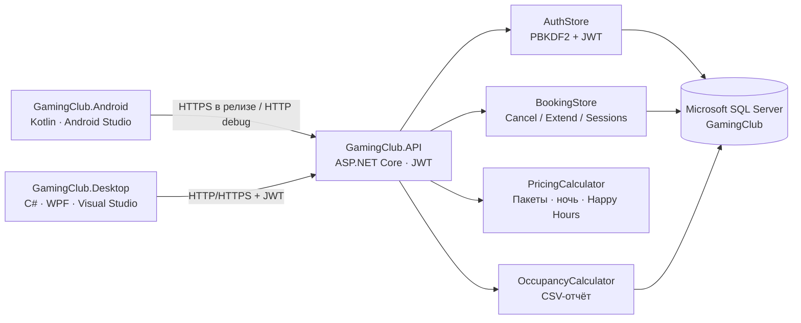
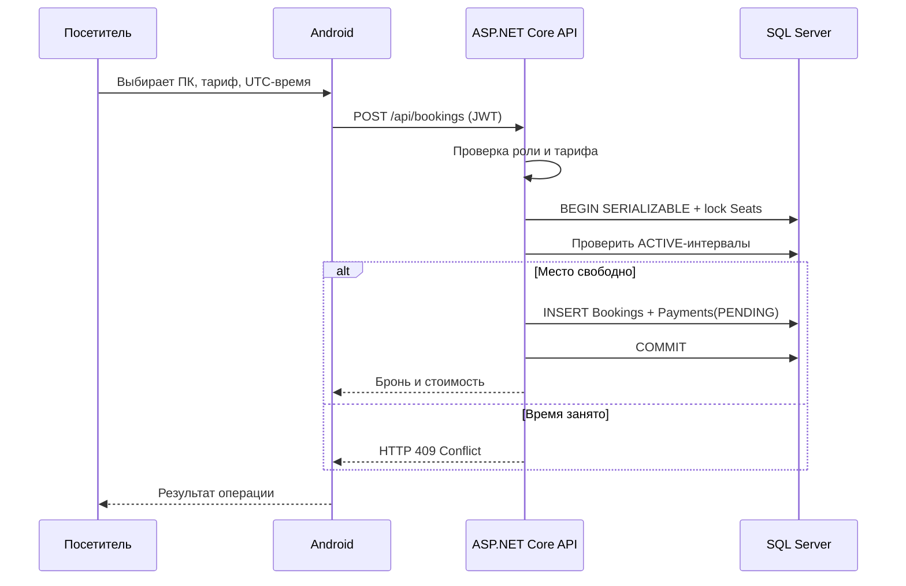
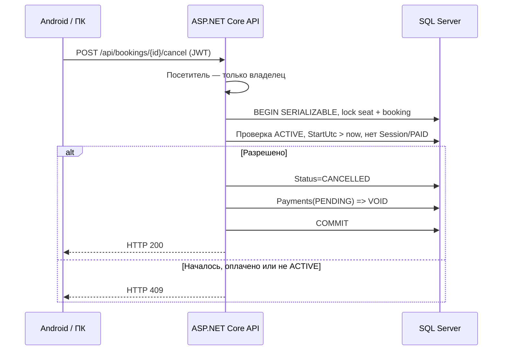

# Архитектура GamingClub — вариант 18

## Компоненты

**Единый источник истины:** клиенты получают места, бронирования, цены и таймер с сервера. Android не может напрямую изменять SQL. Запись в базу выполняет API.

## Последовательность бронирования

## Отмена бронирования

## Структура данных и алгоритмы

- **8 таблиц**: Roles, Users, Halls, Seats, Tariffs, Bookings, Sessions, Payments; детали в `docs/er-diagram.md`.
- **Алгоритм тарификации**: расчёт стоимости пакета, ночного/льготного и почасового тарифа; разница при продлении.
- **Алгоритм загрузки зала**: объединение перекрывающихся интервалов и расчёт занятых компьютер-минут к ёмкости зала.
- **Блокировка двойной записи**: изоляция SERIALIZABLE и одинаковый порядок захвата блокировок при создании/продлении/отмене.
- **Безопасность**: PBKDF2-хеш паролей, JWT, проверка роли ADMIN и владельца бронирования.

## Технические ограничения прототипа

- HTTP для Android разрешён только в debug; production требует HTTPS.
- Время тарифных окон пока интерпретируется как UTC, хотя поля называются LocalTime. Требуется согласовать часовой пояс клуба.
- Прототип API имеет старые открытые маршруты `/api/dev/*`, доступные **только в режиме Development**. Не открывать такой сервер в сеть.
- Платёжный шлюз не реализован. `PENDING` — начисление, `VOID` — аннулированное до оплаты начисление, **не возврат денег**.
- Полноценные интеграционные тесты и UI-проверка не выполнены. Описанные схемы отражают исходный код, а не подтверждённую эксплуатацию.
