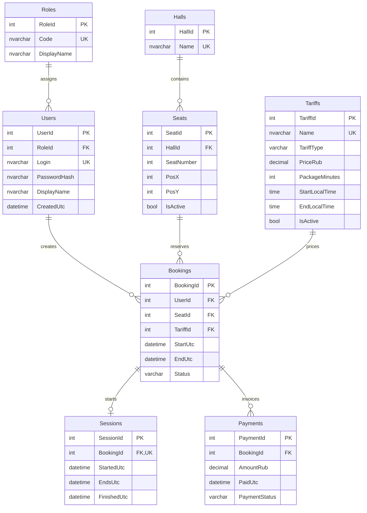

# ER-модель GamingClub (вариант 18)

База данных: Microsoft SQL Server. Скрипт создания: `database/schema.sql`.

## Нормализация

- Справочники ролей, залов и тарифов выделены отдельно от фактов бронирования.
- Компьютер определяется `SeatId`, а номер места уникален в рамках зала.
- Пользователь и выбранный тариф связаны с бронью по внешним ключам.
- Сессия имеет уникальную ссылку на бронь, один сеанс на бронирование.
- Несколько оплат/доплат на одну бронь допускаются.

## Важные ограничения модели

1. Пересечение времени бронирований нельзя предотвратить только уникальным индексом — оно проверяется в серверной SQL-транзакции.
2. `Tariffs.StartLocalTime` и `EndLocalTime` хранят часы тарифа, но часовой пояс клуба в схеме пока отсутствует; прототип тарификации использует UTC, поэтому правила ночного тарифа нужно уточнить.
3. В схеме нет истории изменения тарифов и активных игровых мест, поэтому старые отчёты могут пересчитываться с текущими значениями.
4. `Payments` в прототипе означает начисления, настоящие денежные операции не подключены.
5. Авторизация и хеширование новых паролей будут добавлены отдельным этапом.

Для прикрепления к отчёту диаграмму необходимо экспортировать в PNG/SVG из Mermaid-редактора или оформить в Figma; пока здесь представлена исходная схема, а не графический файл.
